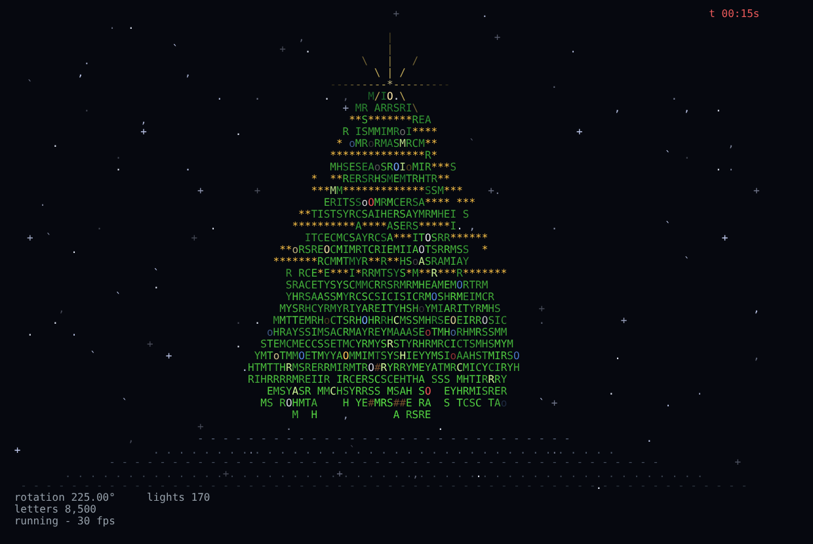

# ASCII 크리스마스 트리

터미널에서 돌아가는 3D 회전 크리스마스 트리입니다. 글자 8,500개로 나무를 만들고, 줄기에서 바깥으로 자라난 뒤 황금 전구 줄·장식 공·반짝이는 전구·별이 붙습니다. Python + NumPy만 씁니다.



> **브라우저에서 보려면** [`web/index.html`](web/index.html) 을 열면 됩니다(HTML 캔버스 버전, 파일 하나, 설치 불필요). 글자가 빛나고 별에서 광선이 퍼지는 더 부드러운 버전입니다. 자세한 건 [web/README.md](web/README.md).


## 실행

```bash
pip install -r requirements.txt
python3 xmas_tree.py
```

Ctrl-C로 끝냅니다(터미널 화면과 커서는 원래대로 돌아옵니다). 24비트(트루컬러)를 지원하는 터미널이 필요합니다. Windows Terminal, iTerm2, VS Code 터미널 등은 됩니다.
터미널 크기에 맞춰 그려지며 창 크기를 바꾸면 따라갑니다. 세로 40줄, 가로 100칸 이상을 권합니다.

| 옵션 | 기본 | 설명 |
|---|---|---|
| `--letters N` | 8500 | 나무를 이루는 글자 수 (97 이상) |
| `--text 글자` | MERRY CHRISTMAS | 나무에 쓸 글자 |
| `--lights N` | 170 | 전구 수 |
| `--ornaments N` | 26 | 장식 공 수 |
| `--spin 도` | 15 | 초당 회전 각도 |
| `--fps N` | 30 | 프레임 속도 |
| `--duration 초` | 없음 | 이 시간 뒤 종료 |
| `--seed N` | 7 | 같은 값이면 같은 나무 |
| `--frames N --start 초 --plain` | | 색 없이 글자로 N프레임만 출력(파일 저장·확인용) |

예: `python3 xmas_tree.py --text "HAPPY NEW YEAR" --letters 12000 --spin 25`

## 만드는 방식

1. **가지**: 층(9개)마다 가지를 방사형으로 뻗고, 아래층일수록 가지가 많습니다. 층마다 각도를 황금비(0.618)만큼 어긋나게 돌려 놓습니다.
2. **글자**: 가지마다 점을 뿌립니다. 끝쪽에 더 몰리고, 끝으로 갈수록 처지며, 옆으로 퍼집니다. 점 하나가 글자 하나입니다.
3. **자라기**: 줄기 가까운 곳·꼭대기부터 바깥·아래로 10초 동안 글자가 늘어납니다(453개에서 시작).
4. **그리기**: y축 회전 → 원근 투영 → z-버퍼(가까운 글자가 이김) → 깊이와 가지 위치에 따른 명암 → 24비트 ANSI 색.
5. 터미널 글자 칸은 세로가 가로의 약 2배라서 가로를 2배로 늘려 둥글게 보이게 합니다.

## 테스트

```bash
python3 -I -m unittest -v
```

40개입니다. 투영·z-버퍼·성장·장식 시점·HUD 같은 로직과 CLI를 검사합니다. 코드를 일부러 망가뜨려(예: z-버퍼가 먼 글자를 고르게 하거나, 눈이 위로 올라가게 하거나, 가로 보정을 빼는 등 변이 20여 종) 테스트가 실패하는지 확인했습니다.

## 한계

- 터미널 글자 격자(예: 100×40칸)가 해상도의 전부라서, 사진처럼 부드러운 그림은 아닙니다. 터미널이 클수록 더 정교해 보입니다.
- 색은 24비트를 가정합니다. 256색만 지원하는 터미널에서는 색이 어긋나거나 깨질 수 있습니다(확인하지 않았습니다).
- 실제 속도는 터미널 렌더링에 달려 있습니다. 계산은 프레임당 약 7ms이고, 가상 터미널에서 30fps를 확인했지만 느린 터미널 에뮬레이터에서는 끊길 수 있습니다.
